<div align="center">

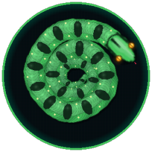

# 🐍 Snake Advanced

**Il classico Snake, rinato.** Un serpente realistico che striscia, salta, sputa veleno e si teletrasporta,
in un'arena piena di rivali, mine, tunnel e un boss che ti dà la caccia.

[](https://www.python.org/)
[](https://pyga.me/)
[](#-download)
[](#-sviluppo)
[](#-sviluppo)
[](#-musica-e-suoni-generati-dal-codice)

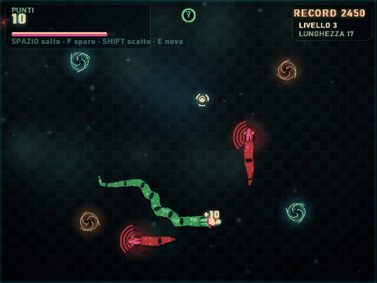

<a href="https://github.com/robycinix/SnakeAdvanced/releases/latest/download/SnakeAdvanced-Setup.exe"></a>
<a href="https://github.com/robycinix/SnakeAdvanced/releases/latest"></a>

[**Download**](#-download) · [**Caratteristiche**](#-caratteristiche) · [**Comandi**](#-comandi) · [**Come è fatto**](#-come-è-fatto) · [**Sviluppo**](#-sviluppo)

</div>

---

## 📥 Download

| Versione | Per chi | Come |
| :--- | :--- | :--- |
| **Installer Windows** | Chiunque: niente Python richiesto | [**⬇ SnakeAdvanced-Setup.exe**](https://github.com/robycinix/SnakeAdvanced/releases/latest/download/SnakeAdvanced-Setup.exe) (31 MB) |
| **Portatile** | Chi non vuole installare nulla | [**⬇ SnakeAdvanced.exe**](https://github.com/robycinix/SnakeAdvanced/releases/latest/download/SnakeAdvanced.exe) (28 MB): doppio clic e si gioca |
| **Da sorgente** | Sviluppatori | `pip install -r requirements.txt` e `python game.py` |

> [!NOTE]
> L'eseguibile non è firmato digitalmente: Windows SmartScreen può mostrare "app non riconosciuta".
> Clicca **Ulteriori informazioni → Esegui comunque**.

---

## ✨ Caratteristiche

### 🐍 Un serpente che sembra vivo

Niente quadratini: il corpo è un **tubo continuo ombreggiato come un cilindro**, illuminato dall'alto,
con **selle dorsali da pitone**, riflessi umidi e un'**ombra proiettata** sul terreno.

- **Movimento fluido** a 120 FPS, interpolato tra un passo e l'altro della griglia
- **Ondulazione laterale ancorata al terreno**: il corpo segue la stessa curva della testa, come un vero rettile
- **Le prede ingoiate scendono lungo il corpo** come un rigonfiamento
- **Lingua biforcuta** che guizza (più spesso quando c'è cibo vicino), occhi a fessura luminosi
- Coda affusolata, collo sottile, testa a spatola che ruota dolcemente in curva

### ⚡ Azioni potenti

| Azione | Tasto | Cosa fa |
| :--- | :---: | :--- |
| 🦘 **Salto** | `SPAZIO` | Scavalca 3 celle: il tuo corpo, i rivali, le mine. L'arco scorre lungo tutto il corpo e l'ombra resta a terra. Attento all'atterraggio! |
| 🧪 **Veleno** | `F` / `CTRL` | Sputo a proiettile: alla testa elimina un rivale, sul corpo lo **taglia in due**, fa esplodere le mine. Passa anche nei tunnel. |
| 💨 **Scatto** | `SHIFT` | Velocità doppia con scia di plasma: **sfonda mine e rivali** al contatto. |
| 💥 **Nova** | `E` / `Q` | A energia piena: onda d'urto che **polverizza** mine e rivali nel raggio e ferisce il boss. |

<div align="center">
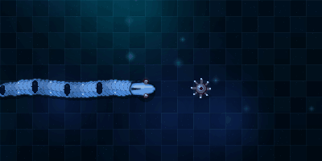
&nbsp;
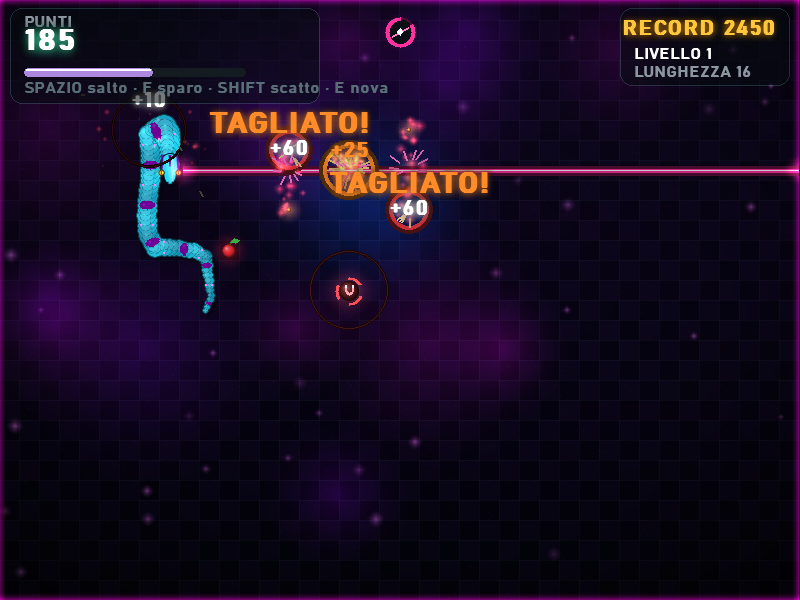
</div>

### 🎁 Power-up

| | Power-up | Effetto |
| :---: | :--- | :--- |
| 🟠 | **Turbo** | Velocità aumentata |
| 🔵 | **Scudo** | Assorbe un impatto; contro il muro diventa un **portale** verso il lato opposto |
| 🟣 | **Bullet Time** | Rallenta tutto, anche i nemici, con l'immagine che vira al blu |
| ⚪ | **Fantasma** | Attraversi il tuo corpo e quello dei rivali |
| 🔴 | **Magnete** | Attira il cibo con **fulmini** visibili |
| 🟢 | **Triplo Veleno** | Spari a ventaglio, tre colpi alla volta |
| 💗 | **Laser** | Raggio istantaneo e perforante, gratis finché dura |

Più **frutto d'oro** a tempo (50 punti), **combo fino a x5** e un livello che sale ogni 5 frutti.

### 🌀 Tunnel di teletrasporto

Coppie di vortici dello stesso colore si aprono a caso nell'arena: entri da uno ed **esci dall'altro**
mantenendo la direzione. Il corpo viene "risucchiato" dalla spirale e riemerge dall'altra parte.
Funzionano anche per **rivali, boss e proiettili**. Se l'uscita è ostruita il tunnel non trasporta:
meglio niente teletrasporto che una morte ingiusta.

### 🐉 Rivali e boss

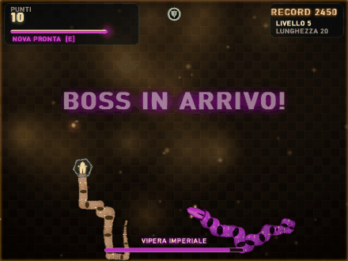

- **Dal livello 3** arrivano **serpenti rivali** guidati da un'IA che punta al tuo cibo ("RUBATO!").
  Falli schiantare contro il tuo corpo, tagliali col veleno o con lo scatto: esplodono in frammenti di cibo.
- **Ogni 5 livelli** emerge da un portale la **Vipera Imperiale**: enorme, ti **dà la caccia**,
  attraversa i muri e ti **morde la coda**. La sconfiggi accorciandola pezzo dopo pezzo con veleno,
  scatto, Nova e mine. Vale **500 punti** e lancia fuochi d'artificio.
- Le **mine** compaiono col tempo e lampeggiano prima di armarsi.

<br clear="right">

### 🎨 Quattro mondi

<div align="center">
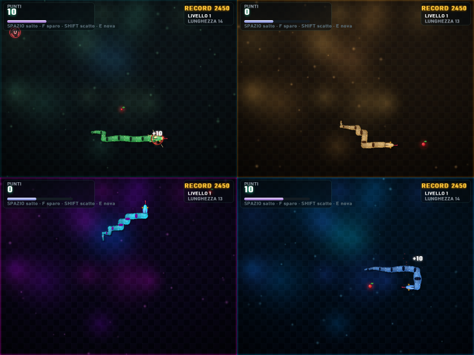
</div>

**Giungla**, **Deserto**, **Neon** e **Abisso**: ogni tema cambia terreno, luci, bordo dell'arena,
lucciole e pelle del serpente. Si cambia con `T` nel menu e la scelta viene ricordata.

### 🏆 Classifica

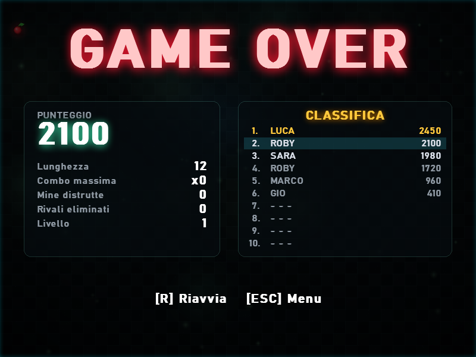

- **Top 10** con nome: se entri in classifica lo scrivi a fine partita
- La tua posizione lampeggia nella tabella
- Statistiche della partita: lunghezza, combo massima, mine distrutte, rivali eliminati
- Classifica visibile anche nel menu (`TAB`)

<br clear="right">

### 🎵 Musica e suoni generati dal codice

Non c'è **nemmeno un file audio** nel progetto. Effetti sonori e musica sono **sintetizzati al volo**:

- **3 brani in loop** sintetizzati con `numpy` (basso, arpeggi, pad e batteria): calmo nel menu,
  incalzante in partita, aggressivo in minore durante il boss, con **dissolvenza incrociata** tra l'uno e l'altro
- Una ventina di effetti: morsi con tono crescente in combo, esplosioni, teletrasporto, laser, salto e atterraggio…

### 📦 Un installer a tema

<div align="center">
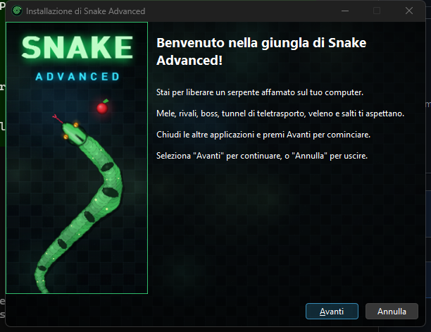
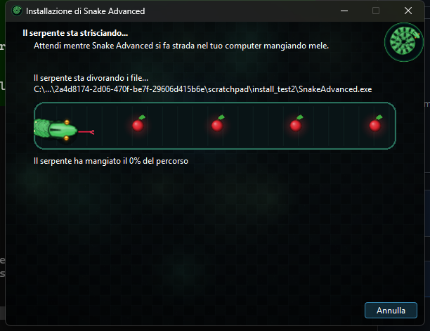
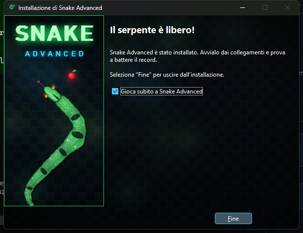
</div>

Tema scuro "giungla notturna" e testi in tema ("Il serpente sta divorando i file…").
**La barra di avanzamento è un serpente** che si allunga mangiando mele. Tutta la grafica dell'installer
viene disegnata dal motore del gioco stesso.

---

## 🎮 Comandi

| Tasto | Azione |
| :--- | :--- |
| `Frecce` / `WASD` | Muovi il serpente |
| `SPAZIO` | Salto (in partita) · Inizia (nel menu) |
| `F` / `CTRL` (tieni premuto) | Sputa veleno |
| `SHIFT` (tieni premuto) | Scatto |
| `E` / `Q` | Nova (con energia piena) |
| `P` | Pausa |
| `T` · `TAB` | Cambia tema · Mostra la classifica (nel menu) |
| `M` | Audio e musica on/off |
| `F11` | Schermo intero |
| `R` / `ESC` | Riavvia / Torna al menu (a fine partita) |

<details>
<summary><b>💡 Consigli per sopravvivere</b></summary>

- L'**energia** alimenta scatto, veleno e Nova: si ricarica mangiando e col tempo. Non sprecarla tutta.
- Un rivale che sbatte contro il **tuo corpo** muore: chiudilo in un angolo invece di sparargli.
- Il **salto** ti salva quando ti sei chiuso da solo, ma controlla dove atterri.
- Lo **scudo** contro il muro diventa un portale: usalo per scappare dal boss.
- Il **Bullet Time** rallenta anche i nemici: è il momento giusto per tagliare il boss.
- Il bordo dell'arena si accende di **rosso** quando sei vicino al muro.

</details>

---

## 🛠️ Come è fatto

Python + **pygame-ce**, architettura **Model / View / Controller** a oggetti.

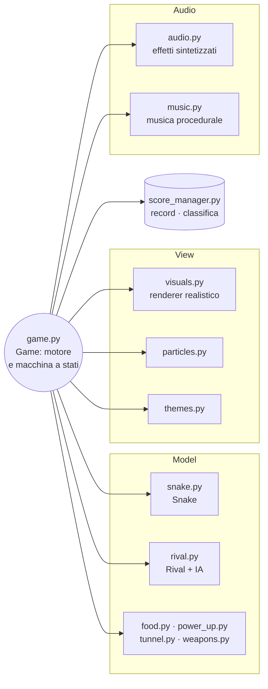

<details>
<summary><b>🔬 Dettagli tecnici</b></summary>

- **Delta Time, sempre**: la logica avanza a passi discreti sulla griglia scanditi da un accumulatore
  di tempo, indipendente dagli FPS; rivali e proiettili hanno i loro accumulatori.
- **Buffer di direzione** (`next_direction`): niente inversioni di 180° anche premendo due tasti nello stesso passo.
- **Rendering interpolato**: il serpente viene disegnato tra il passo precedente e quello corrente,
  campionato fittamente e riempito di dischi anti-aliasati a strati (contorno, base, fascia di luce, riflesso).
- **Ondulazione ancorata al terreno**: la fase dipende da `distanza percorsa - posizione nel corpo`,
  così ogni punto del corpo ripercorre esattamente la curva della testa.
- **Salto ancorato al terreno**: il segmento *i* è in volo se lo era la testa *i* passi fa, quindi l'arco
  scorre lungo il corpo come in un vero balzo.
- **Rendering a regioni**: ogni serpente pulisce e compone solo il proprio rettangolo, così più serpenti a schermo costano poco.
- **IA dei rivali**: inseguimento del bersaglio con *flood fill* limitato per evitare i vicoli ciechi;
  il boss punta alla cella davanti alla tua testa.
- **Proiettili a sotto-passi** (al massimo mezza cella per passo): anche a 28 celle/s non attraversano i bersagli.
- **Cache di sprite**: luci additive, dischi e teste ruotate vengono generati una sola volta.
- **Musica in un thread** all'avvio: la finestra si apre subito e i brani entrano appena pronti.
- **Dati del giocatore** accanto al codice o, nell'eseguibile, in `%APPDATA%/SnakeAdvanced`.

</details>

<details>
<summary><b>📁 Struttura del progetto</b></summary>

```
SnakeAdvanced/
├── game.py            # Motore: stati, input, logica, HUD e rendering del mondo
├── snake.py           # Il serpente: corpo, buffer di direzione, collisioni
├── rival.py           # Serpenti rivali e boss con IA
├── food.py            # Frutto, frutto d'oro, frammenti
├── power_up.py        # Power-up e mine
├── tunnel.py          # Tunnel di teletrasporto
├── weapons.py         # Proiettili di veleno
├── visuals.py         # Renderer realistico, luci, sfondo, icone
├── particles.py       # Particelle, scintille e onde d'urto
├── themes.py          # I quattro temi grafici
├── audio.py           # Effetti sonori sintetizzati
├── music.py           # Musica procedurale (numpy)
├── score_manager.py   # Record, classifica e preferenze in JSON
├── config.py          # Tutte le costanti di bilanciamento
├── build.py           # Icona, grafica installer, exe (PyInstaller) e setup (Inno Setup)
├── installer/         # Script Inno Setup con barra-serpente in Pascal Script
├── docs/              # Media della pagina e generatore (make_media.py)
└── test_*.py          # Test con pytest
```

</details>

---

## 👩‍💻 Sviluppo

```bash
git clone https://github.com/robycinix/SnakeAdvanced.git
cd SnakeAdvanced
pip install -r requirements-dev.txt

python game.py              # gioca
pytest                      # 37 test (logica, armi, tunnel, salto, rivali, classifica…)
mypy --ignore-missing-imports .
python build.py             # exe + installer in dist/ (installer se c'è Inno Setup 6.7+)
python docs/make_media.py   # rigenera GIF e screenshot di questa pagina
```

Tutti i numeri del gioco (velocità, energia, durate, punteggi) sono in [`config.py`](config.py):
il bilanciamento si regola da lì. Le convenzioni del progetto sono in [`AGENTS.md`](AGENTS.md)
e la specifica originale in [`docs/SPECIFICA.md`](docs/SPECIFICA.md).

---

<div align="center">

Fatto con 🐍 e un po' di pazzia da **[Roby](https://github.com/robycinix)**, con l'aiuto di Claude.

*Le GIF e gli screenshot di questa pagina sono catturati dal vero motore del gioco.*

</div>
